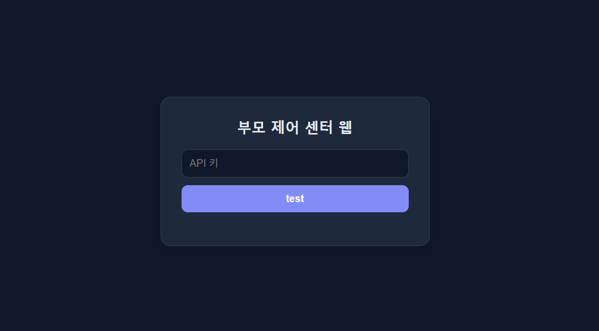

# ComputeDefend

Windows에서 실행 중인 앱을 웹으로 확인하고 종료를 요청하는 컴퓨터 관리 MVP입니다. C++ 클라이언트, Python FastAPI 서버, HTML/CSS/JavaScript 화면으로 구성됩니다.

자녀 컴퓨터 제어 앱의 비용 부담과 시험 기간의 컴퓨터 사용 조절 문제에서 출발했습니다. 개발 배경 원문은 [docs/howToUse.md](docs/howToUse.md), 카카오 AI 루키 캠프 지원용 소개 페이지는 [portfolio/](portfolio/README.md)에 있습니다.

## 현재 구현

- 화면에 보이는 최상위 창을 가진 Windows 앱의 이름과 PID 수집
- 1초 간격으로 목록 확인 및 종료 명령 폴링, 목록 변경 시 전송 (30초마다 재전송)
- 웹의 종료 요청을 큐에 저장하고 C++에서 이름·PID를 다시 확인해 실행
- SSE로 브라우저 목록 갱신, Fetch API로 종료 요청 전송
- API 키 인증, Upstash Redis 저장소 및 로컬 메모리 저장소 지원

컴퓨터 종료, 타이머, 종합 관리 기능은 향후 계획입니다.

## 구조

```text
Windows C++ ──HTTP POST/GET── FastAPI ──SSE──▶ 브라우저
                             ▲                 │
                             └──── fetch ──────┘
                             │
                       Upstash Redis
                    (미설정 시 로컬 메모리)
```

| 경로 | 역할 |
| --- | --- |
| `src/main.cpp`, `src/main.hpp` | WinAPI 앱 수집·종료, HTTP 통신, RAII 핸들 정리 |
| `src/Web/BackEnd/main.py` | FastAPI API, 명령 큐, SSE, 웹 정적 파일 제공 |
| `src/Web/FrontEnd/` | 실제 관리 화면 |
| `portfolio/` | 소개용 정적 랜딩 페이지와 이미지 |
| `docs/` | 제공된 개발 경험 원문과 스크린샷 |
| `Planner/` | 기획 및 설계 기록 |

## 로컬 실행

Python 3.12 이상을 사용합니다. 저장소 루트에서 PowerShell로 실행합니다.

```powershell
python -m venv .venv
.\.venv\Scripts\python.exe -m pip install -r requirements.txt
$env:API_KEY = 'replace-with-your-own-key'
.\.venv\Scripts\python.exe -m uvicorn src.Web.BackEnd.main:app --reload --host 127.0.0.1 --port 8000
```

<http://127.0.0.1:8000>에서 같은 키를 입력하고 `test` 버튼으로 연결합니다. Redis 변수가 없으면 목록과 명령은 메모리에 저장되며 서버 재시작 시 사라집니다. `API_KEY`가 없으면 로컬 인증을 생략하므로 외부에 노출하지 않습니다.

C++ 클라이언트는 Windows, C++20, MSVC, CMake 3.28 이상(현재 프리셋 형식), Ninja가 필요합니다. Visual Studio x64 개발자 환경에서 빌드합니다. CMake가 CPR 및 nlohmann/json을 내려받습니다.

```powershell
cmake --preset ninja-release
cmake --build --preset ninja-release
$env:COMPUTER_DEFENDER_URL = 'http://127.0.0.1:8000'
$env:COMPUTER_DEFENDER_API_KEY = 'replace-with-your-own-key'
.\out\build\ninja-release\ComputerDefender.exe
```

서버와 클라이언트는 같은 API 키를 사용해야 합니다. 종료 요청은 실제 앱을 종료하므로 저장하지 않은 작업이 없는 앱으로 확인합니다. 현재 저장소는 단일 목록·명령 큐를 사용하며 PC별로 분리하지 않습니다.

## 환경변수

| 변수 | 용도 |
| --- | --- |
| `API_KEY` | 서버 인증 키 (`X-API-Key`, SSE는 `api_key` 쿼리) |
| `UPSTASH_REDIS_REST_URL` / `UPSTASH_REDIS_REST_TOKEN` | Redis REST 연결 |
| `KV_REST_API_URL` / `KV_REST_API_TOKEN` | 위 Redis 변수의 대체 이름 |
| `COMPUTER_DEFENDER_URL` | C++ 연결 서버, 기본값 `http://127.0.0.1:8000` |
| `COMPUTER_DEFENDER_API_KEY` | C++ 인증 키 |

`pyproject.toml`에는 FastAPI 진입점이 선언되어 있습니다. 실제 제어 서버를 별도로 배포할 때 `VERCEL` 환경에서는 API 키와 Redis 설정이 필요합니다.

`docs/howToUse.md`에는 Supabase/PostgreSQL 구상이 남아 있지만, 현재 소스의 저장소 구현은 Upstash Redis입니다.

## 랜딩 페이지 미리보기

공개 주소: <https://compute-defender.vercel.app/>. 저장소 루트의 `vercel.json`은 프레임워크를 `Other`로 지정하고 `portfolio/`만 정적 배포합니다. 설치·빌드 단계가 없으며 랜딩 페이지에는 API 키나 Redis가 필요하지 않습니다.

Vercel 프로젝트의 Root Directory는 저장소 루트(`.`), Production Branch는 `main`으로 설정합니다. Git 연동으로 `main` 푸시 후 자동 재배포되며, 연동되지 않았다면 Vercel에서 해당 커밋을 배포해야 합니다. 이 설정은 실제 프로세스 제어 서버를 함께 배포하지 않습니다.

```powershell
python -m http.server 8765 --bind 127.0.0.1 --directory portfolio
```

<http://127.0.0.1:8765>에서 확인합니다. 별도 빌드가 필요 없으며 실제 관리 화면과 독립적입니다.



[앱 목록 스크린샷 보기](portfolio/assets/images/process-list.png)

2026-11-17: 개발 경험과 제공된 이미지를 반영했습니다. 최신 앱 목록으로 교체하고 C++ 통신 로그를 추가했으며, FastAPI 자동 실행 대신 랜딩 페이지를 정적 배포하도록 Vercel 설정을 명시했습니다. 페이지 구성과 수정 방법은 [포트폴리오 README](portfolio/README.md)를 참고하세요.
